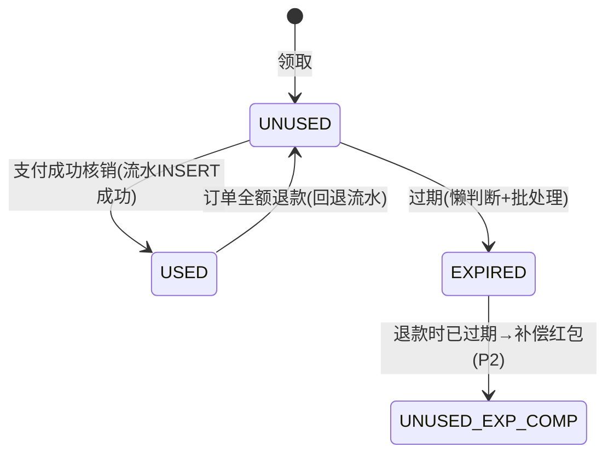
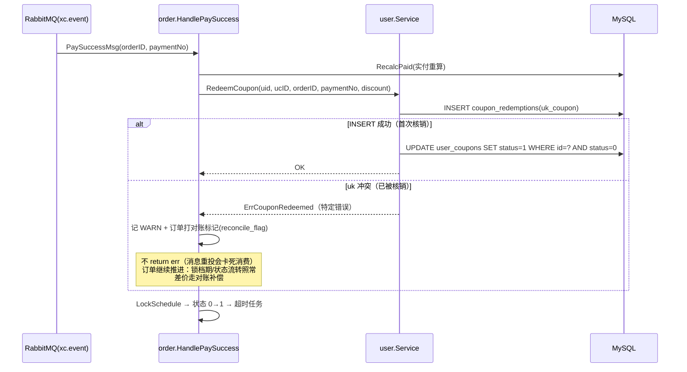

# 优惠券核销企业级方案（乡厨系统）

> 状态：设计稿 v1
> 关联代码：`server/internal/modules/order/service.go`（chargeWithCoupon / HandlePaySuccess）、`server/internal/modules/user/repo.go`（UseCoupon / ReleaseCoupon）
> 关联表：`user_coupons`、`orders`、`payments`

## 1. 背景与问题

现状是「三段式」：下单仅校验（`chargeWithCoupon` 只读 `status=0`）、支付成功核销（`UseCoupon` 无条件 `UPDATE status=1`）、取消/退款释放（`ReleaseCoupon` 带 `status=1` 条件回退）。

该设计存在一条真实资损路径：

```
同一张券（ucID=X）同时挂到 N 笔未支付订单
  → 每笔下单校验都通过（只看 status=0，无任何锁定），amount 均按折后价快照
  → N 笔全部支付成功
  → 每笔 HandlePaySuccess 都调 UseCoupon，无条件更新只是覆盖 order_id，无报错
  → 平台按 N 笔各少收一张券面额
```

根因：**核销不是原子操作**（校验与写入分离，且写入无条件），**且没有核销流水**（无法对账发现异常）。

## 2. 目标与非目标

**目标**

1. 一张券最多被一笔订单核销，核销动作原子、幂等
2. 核销产生不可变流水，可审计、可对账，异常可发现
3. 取消/退款正确回退券，回退本身可重复执行（幂等）
4. 支付成功消息重投、并发消费等异常下不阻塞订单主流程

**非目标（本方案不覆盖，见 §8 分期）**

- 单品级优惠分摊与部分退款按比例回退
- 营销预算池与抢券（秒杀领券）场景
- 券营销效果分析

## 3. 总体设计：三层防御

```
┌─ 第 1 层：原子核销（权威）──────────────────────────┐
│ 核销流水表 coupon_redemptions，coupon_id 唯一索引     │
│ INSERT 冲突 = 已核销。流水是唯一权威事实。             │
├─ 第 2 层：状态投影 ────────────────────────────────┤
│ user_coupons.status 由流水驱动更新（0未用/1已用/2冻结）│
│ 仅作查询加速与业务展示，可随时由流水重建。             │
└─ 第 3 层：对账兜底 ────────────────────────────────┘
  定时任务核对 流水 ↔ 订单 ↔ 券状态，不一致出告警工单
```

设计原则：**流水为权威，状态为投影**。任何时刻可以从流水重建券状态；状态改错了流水还在，对账能发现。这与本系统「订单状态机 + 支付流水（payments 表）」的既有哲学一致。

## 4. 状态机与表变更

### 4.1 券实例状态机（user_coupons.status）



状态取值：`0` 未使用 / `1` 已使用 / `2` 已冻结（被未支付订单预占，P1 引入，见 §8）；**过期不落状态值**，按 `expire_at` 懒判断（查询时 `valid_to > NOW()`）。

> 说明：企业交易券的完整状态机含「冻结（下单预占）」态，见 §8 P1。引入冻结的前置条件是**未支付订单必须有生命周期终点**（当前未支付订单可无限期重拉支付，无自动过期），否则冻结会泄漏。故 P0 先以「支付点原子核销」堵资损，P1 再上冻结模型。

### 4.2 新增核销流水表

```sql
-- 000002_coupon_redemption.up.sql
CREATE TABLE `coupon_redemptions` (
  `id`             bigint       NOT NULL AUTO_INCREMENT,
  `coupon_user_id` bigint       NOT NULL COMMENT 'user_coupons.id',
  `order_id`       bigint       NOT NULL COMMENT '核销订单',
  `payment_no`     varchar(32)  NOT NULL DEFAULT '' COMMENT '触发核销的支付流水号(幂等键之一)',
  `discount`       bigint       NOT NULL COMMENT '本次核销抵扣金额(分)',
  `status`         tinyint      NOT NULL DEFAULT 1 COMMENT '1有效 2已随退款回退',
  `created_at`     datetime(3)  NOT NULL DEFAULT CURRENT_TIMESTAMP(3),
  PRIMARY KEY (`id`),
  UNIQUE KEY `uk_coupon` (`coupon_user_id`)              COMMENT '一券一次有效核销——原子性来源',
  KEY `idx_order` (`order_id`),
  KEY `idx_payment` (`payment_no`)
) ENGINE=InnoDB DEFAULT CHARSET=utf8mb4 COLLATE=utf8mb4_unicode_ci;
```

关键点：

- `uk_coupon` 唯一索引是**原子性的全部来源**：并发 INSERT 只有一个成功，数据库保证，无需应用层锁
- `status=2` 回退不是删流水：核销历史不可变，回退是追加语义（退回券 + 流水置回退态），对账才能两边核
- 回退流水（退款方向）P2 可再加 `coupon_refunds` 表；P0 用 status 字段表达

### 4.3 存量数据回填

上线前核对 `user_coupons`（status=1）与 `orders.user_coupon_id`，为历史已核销券补插流水（`discount` 取 `orders.amount` 与券面额反推），保证唯一索引对存量也成立。

## 5. 关键流程

### 5.1 支付成功核销（含冲突降级）



**冲突降级是本方案的灵魂**：钱已收，砍单的损失大于券面额，所以核销冲突只降级不回滚；同时必须留下机器可读的痕迹（对账标记/告警），把「静默覆盖」变成「有声的异常」。

### 5.2 取消/退款回退

```
入口：订单取消 / 售后全额退款（现有两处 ReleaseCoupon 调用点替换）
动作（幂等，可重复执行）：
  1. UPDATE coupon_redemptions SET status=2 WHERE coupon_user_id=? AND status=1
     —— 影响行数=0 说明已回退过，直接返回成功
  2. UPDATE user_coupons SET status=0 WHERE id=?
     —— 券回到未使用；若券已过期(P2)，改发等额补偿红包，不再复活过期券
```

### 5.3 下单校验（不变 + 一处收紧）

`chargeWithCoupon` 逻辑不变（存在/归属/未使用/未过期/门槛/类型），仍**不占状态**——P0 阶段下单侧保持零写入，把改动面压到最小。

## 6. 边界场景矩阵

| 场景 | 行为 | 依据 |
|---|---|---|
| 支付成功消息重投 | 幂等：订单状态机 `Transition 0→1` 挡住；流水表无需重复处理 | 现有 `Transition` + 订单状态判断 |
| 两笔订单并发支付用同一券 | 后者 INSERT 流水冲突 → 降级对账路径 | `uk_coupon` |
| 核销成功但后续 LockSchedule 失败 | 整条消费报错重投；重投时流水 INSERT 再冲突 → 走降级路径但订单仍是未支付态？ | **注意**：降级分支必须先判订单状态，未支付态的冲突要放行重试而非打标记（见 §7 实现要点） |
| 取消接口被重复调用 | 回退幂等：`WHERE status=1` 影响行数=0 即成功 | §5.2 |
| 券已过期但订单退款 | P0：仍回 `status=0`（复活）；P2：过期券改发补偿红包 | §8 |
| 流水表与券状态不一致 | 对账 job 发现 → 告警工单，以流水为准修复投影 | §7 对账 |
| payments 表无该 paymentNo | 消费前置校验已存在（`PaymentAmountByNo`），不变 | HandlePaySuccess 现状 |

## 7. 监控与对账

**实时指标（打点即可，先日志后 metrics）**

- `coupon_redeem_conflict_total`：核销冲突次数。>0 即有人撞上窗口，看趋势决定是否升级 P1
- `coupon_redeem_ok_total` / `coupon_release_total`
- 带 reconcile 标记的订单数：>0 必须人工跟进

**对账 job（P1 上线，每日 T+1）**

```
SELECT 券核销流水 JOIN 订单 JOIN 券实例，核对三条等式：
  1. 每条有效流水.order_id 对应订单存在且 user_coupon_id=流水.coupon_user_id
  2. 每个订单.user_coupon_id>0 且订单已支付 ⇒ 存在对应有效流水
  3. 每个 status=1 的券 ⇒ 恰有一条有效流水
任一不成立 → 告警 + 出修复 SQL 建议（人工确认后执行）
```

**实现要点（写代码前必读）**

1. `RedeemCoupon` 放 user 模块（owner），order 通过 Service 接口调用——符合模块铁律；冲突用特定哨兵错误（如 `errs.ErrCouponRedeemed`）传递，order 侧 `errors.Is` 分流
2. 降级分支前置判断订单当前状态：仅「状态即将从 0→1 的首付消费」的冲突才打对账标记；消息重投导致的二次消费不应误报
3. `discount` 从订单快照取（`orders.amount` 与原价反推），不从券表现读——券面额可能被后台调整，快照为准（同 deposit 快照哲学）
4. 迁移遵循双同步纪律：改模型 → 写 `000002_*.up/down.sql` → `task server:migrate` → 同步 `docs/schema.sql`

## 8. 分期落地

| 阶段 | 内容 | 改动面 | 风险 |
|---|---|---|---|
| **P0 堵资损**（1-2 天） | 流水表 + `RedeemCoupon`（条件 INSERT + 投影更新 + 哨兵错误）+ order 消费端冲突降级 + 冲突指标打点 + 存量回填 | user repo/service、order HandlePaySuccess、1 个迁移 | 低；开关不切也兼容（无流水表时报错退化为现状？否——迁移必须先于发布执行） |
| **P1 对账 + 冻结模型**（1 周） | 对账 job；下单冻结券（status=2）+ 支付核销 + 超时/取消解冻；**前置**：未支付订单引入支付过期自动取消（payments.expire_time 已有，补延迟消息） | +1 延迟消息消费、下单写入路径 | 中；冻结泄漏是主要风险，靠「订单必有过期终点」根治 |
| **P2 规模化**（按需） | 退款补偿红包、部分退款按比例回退、单品优惠分摊、营销预算熔断 | 交易优惠分摊是独立大项 | 高，单独立项 |

**回滚**：P0 全部改动收敛在「核销路径新增流水 + 降级分支」，回滚 = 发布旧版本（流水表保留无害，继续累积）；P1 冻结模型用配置开关 `coupon.freeze_enabled` 控制，可热切回 P0 形态（切回时先解冻全部冻结券）。

## 9. 面试叙事映射

把这份方案讲出来的推荐顺序（对应每层的技术点）：

1. **发现问题**：三段式核销的并发窗口 → 一券多核销资损路径（画时序）
2. **第一反应**：条件更新 + RowsAffected——然后主动指出它的不足：无流水、不可对账、冲突无痕迹
3. **企业级形态**：核销流水表 + 唯一索引做原子权威，状态做投影，可重建可对账（「流水为权威」是这个方案最值得讲的一句话）
4. **分布式难点**：冲突降级——钱已收不能砍单，不阻塞消费队列，留下机器可读痕迹
5. **演进**：冻结模型及其前置条件（订单生命周期终点）；再往上是分摊/回退/预算，点到为止

## 参考（行业公开实践）

- 美团技术团队博客：优惠券系统、交易优惠分摊与退款回退相关文章
- 阿里/京东公开分享：营销核销「流水表 + 唯一索引」幂等模式、Redis 预扣仅用于抢券侧
- 本项目既有同构实践：`payments` 表（流水权威）之于支付、`orders` 状态机之于订单——本方案是同一哲学在券域的复刻
